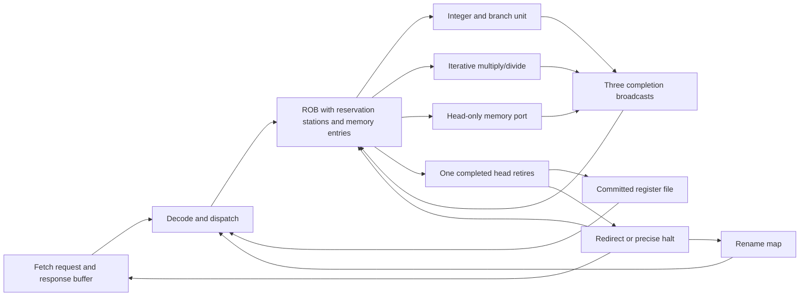

# Engineering mastery: the implemented RV32IM out-of-order processor

This guide explains the hardware in this repository. It is a single-dispatch,
single-retirement educational processor with three execution paths. It is not a
commercial CPU, a VERA reproduction, a privileged RISC-V platform, or a tapeout.
Read `docs/ooo_microarchitecture_spec.md` for contracts and `docs/verification.md`
for evidence. Quantitative results belong to the generated reports, not guesses
about the RTL's appearance.

## 1. Start with the architectural machine

An RV32 instruction observes 32-bit registers, a program counter, and memory.
The sequential interpretation executes one instruction, updates its permitted
state, and moves to its next PC. Register x0 always reads zero. Addition wraps
modulo 2^32. Signed comparisons interpret the same 32 bits as two's complement;
unsigned comparisons do not. Loads assemble little-endian bytes, then sign- or
zero-extend as specified. Stores select byte lanes.

An out-of-order implementation must preserve this observable machine even when
its internal work occurs in another order. It therefore separates **execution**
from **retirement**. Execution computes a speculative result. Retirement makes
that result architectural, in program order. A result being available is not
permission to publish it.

This core's architectural register file is `arch[0:31]` in `rv32_ooo.sv`. Its
speculative values live in ROB entries. There is no separate physical register
file or free list. ROB slots are the physical names of speculative versions.
This is a legitimate renaming scheme, with capacity tied to ROB occupancy.

## 2. Follow one instruction through the actual hardware

1. `rv32_fetch` issues an aligned instruction address. The request remains stable
   until accepted. Only one instruction transaction can be outstanding.
2. A later response fills a one-instruction buffer with PC, bits and access-error
   status. A full ROB can hold this buffer indefinitely.
3. `rv32_decode` identifies architectural sources, destination, source use and
   memory class. It does not perform all legality checking.
4. Dispatch allocates the ROB tail. Each source independently captures zero, an
   architectural value, a completed producer value, a same-edge completion, or
   an unresolved producer tag. The destination updates the rename map afterward.
5. A reservation station is the source-ready/value/tag portion of that ROB entry.
   Completion broadcasts replace unresolved tags with values.
6. An oldest-ready selector scans from the circular head. Integer/branch and M
   instructions have separate selection paths. Memory has a conservative head
   eligibility rule.
7. The integer unit completes in one execution edge; the M unit performs 32
   arithmetic steps. Memory completion depends on the responder and cache.
8. Completion stores a result, sets `done`, and wakes dependent entries. For a
   control transfer it also records `next_pc`; for a fault it records its cause.
9. Only the completed head can retire. A successful destination write updates
   `arch`; a trap produces a precise halt; a wrong predicted next PC causes a
   redirect and flush of all younger work.



## 3. Renaming from first principles

Consider `lw x1,0(x0); add x2,x1,x1; addi x1,x0,9; add x3,x1,x0`.
The load allocates tag T0 and maps x1 to T0. The first add records T0 twice,
regardless of later changes to the map. The ADDI allocates T2 and remaps x1 to
T2. The final add refers to T2, not T0. It can execute when T2 completes even
while the older load remains stalled. When T0 retires, it must not clear the
mapping to T2. The map-clear condition therefore compares the retiring tag with
the current map tag.

This eliminates WAW and WAR false dependencies. It does not eliminate RAW
true dependencies: the first add really needs the loaded value. The source
capture must precede destination renaming logically, even when `rd==rs1`.
Nonblocking clocked assignments and combinational source selection implement
that ordering here.

A free-list physical-register design could let registers outlive ROB entries
and reduce ROB value storage, but would need old-physical-name reclamation and
recovery bookkeeping. This implementation instead returns a physical name when
its ROB slot retires. That is safe because all consumers capture a completion
before the producer can retire, and no old response may survive slot reuse.

## 4. Proving execution order, not just having a ROB

The `ooo` program is:

```text
PC 00: lw   x1,0(x0)       # delayed memory
PC 04: add  x2,x1,x1      # waits for that load
PC 08: addi x3,x0,7       # ready and independent
PC 0c: addi x4,x0,11
PC 10: add  x5,x3,x4
PC 14: sw   x5,4(x0)
PC 18: ebreak
```

PC 08 completes before PC 04. PC 08 cannot retire until PC 00 and PC 04 retire.
`docs/traces/rv32i_ooo.trace` preserves the original verified RV32I checkpoint;
`docs/traces/final_ooo.trace` and `docs/execution_evidence.md` describe the final
configuration. Trace `E` is a completion-edge event for the OoO ALU/M unit,
`A` is dispatch, `F` is redirect, and `R` is the registered retirement event.
Memory request/completion ordering is additionally checked by assertions and
retirement effects; the public `exec_valid` port covers the ALU only.

The following diagram is conceptual; its horizontal spacing is not a measured
cycle count. Use the trace report for measured cycle numbers.

```text
                        time ------------------------------------------------>
load x1          dispatch -- request ------------ response -- retire
add x2,x1,x1       dispatch -- wait for T0 -------- execute ------ retire
addi x3,0,7        dispatch -- execute ---------------------------- retire
addi x4,0,11        dispatch -- execute ----------------------------- retire
add x5,x3,x4         dispatch ---- execute ---------------------------- retire
```

The `md_ooo` test repeats the idea with a divide. A younger independent ADDI
completes while an older divide runs, and its dependent M instruction waits for
the shared M unit to become available. Functional-unit readiness and operand
readiness are separate conditions.

## 5. ROB, queue management and retirement

The supported ROB depths are 16 and 32. Head/tail tags have log2(depth) bits;
occupancy has one extra bit. Equal pointers alone cannot distinguish empty from
full. Allocation fills tail and advances it; retirement clears head and advances
it. Concurrent allocation and retirement leave count unchanged. A full queue
conservatively refuses allocation even if retirement will free a slot at that
edge. This loses an occasional cycle but avoids an additional full-to-dispatch
bypass condition.

Every valid slot must lie in the circular live interval. The testbench checks
that interval, population count, monotonic shadow sequence numbers and valid
rename targets on every active cycle. It also checks that an unresolved source
refers to an older live writer. These invariants are stronger than checking only
that a few final registers look correct.

There is no extra reservation-station free list. Entry capacity and issue-window
capacity are coupled. Completed entries still occupy the ROB until retirement;
they no longer count as waiting reservation stations. A long oldest miss can
therefore fill the window with completed younger instructions and stop fetch.

## 6. Selection, forwarding and completion collisions

The integer selector scans oldest to youngest and stops at the first ready
unissued non-memory, non-M instruction. A separate scan selects the oldest ready
M instruction, subject to `md_ready`. The memory path only considers head.
Consequently single dispatch can coexist with multiple execution/completion
paths in one cycle. This is not dual-wide fetch, rename or retirement.

Three broadcasts carry a ROB identity and value. Existing waiting sources snoop
all three. Dispatch also checks all three so it cannot miss a producer completing
on the same edge. Different destinations can complete simultaneously. They
cannot legitimately complete the same ROB entry: instruction class and issued
state assign each entry to one path. Structural tests count pairwise and triple
completion coincidences.

Completion forwarding is a correctness mechanism as well as a performance
feature. Without dispatch bypass, a new consumer might capture an unresolved
tag just as its only broadcast passes, then wait forever. Without correct tag
lifetime control, a late result could wake an unrelated instruction after wrap.

## 7. Speculation, precise traps and recovery

Fetch predicts PC+4 for every instruction. A taken conditional branch or a jump
usually disagrees. Resolution can happen speculatively, but redirect waits until
the branch reaches retirement. All older instructions have committed by then.
The core commits a successful jump's link value, clears the speculative ROB and
rename map, cancels the M unit, and redirects the frontend.

Waiting until retirement avoids selective ROB truncation, checkpointed maps and
free-list rollback. The price is wasted wrong-path execution and larger redirect
latency. This tradeoff is deliberate and measured; it should not be presented as
a high-performance predictor design.

Instruction fetches cannot be cancelled at the external interface. A redirect
marks a pending or blocked old request stale, preserves its payload through
handshake, drains its response, and then requests the new target. A generation
counter is unnecessary because old and new fetch transactions cannot overlap.
The M unit is different: it is local and synchronously cancellable on flush.

Illegal instructions, instruction/data access errors, alignment faults, ECALL
and EBREAK are recorded precisely. Only a faulting head halts. No destination
write or younger memory effect is allowed to commit on that path. `retire_pc`
and `retire_cause` identify the exception. No CSR save state or trap vector exists;
software cannot return from a trap. Reset is the only restart mechanism.

## 8. Memory queue and memory ordering

Memory entries are bounded by the ROB and hold source readiness, computed
address/write-data/mask and completion state. This is an integrated conservative
memory queue, not a separate associative high-performance LSQ. Only head may
issue a load or store. Thus no load bypasses an older store, resolved or
unresolved, and there is only one accepted data request outstanding.

Stores reach the bus only when oldest. Their request is architecturally
irrevocable: no older branch or exception remains to squash them. Retirement
waits for the response. A responder returning an error must guarantee it did
not change memory. That requirement is part of the bus contract, not something
the CPU can repair afterward.

The core sends an aligned word address and lane-shifted data. SB enables one
lane, SH two aligned lanes and SW all four. A load extracts and extends the
selected lane(s) from the returned word. Misaligned accesses trap before sending
any request. FENCE can complete early internally because retirement and external
memory requests already preserve a stronger order.

Store-to-load forwarding would add little to this serialized first design. A
future LSQ allowing early loads must track older store addresses and data,
combine byte masks correctly, distinguish unknown addresses from known
non-aliases, and detect/replay mis-speculation if it bypasses unresolved stores.
That functionality is not silently assumed here.

## 9. Caches and frontend performance

The separate cache adapter is direct-mapped with one 32-bit word per line. Core
integration uses 16 lines on each port. Reads check valid+tag; misses fetch the
word. Stores write through, update a matching line on success, and never allocate
a missed line. Errors do not poison a line. The cache has no dirty state, coherence,
burst refill, MSHRs or MMIO classification.

Instruction memory must remain immutable while running. There is no FENCE.I or
instruction/data coherence. Cached configurations are for ordinary RAM, not
arbitrary device registers. A word-line cache is intentionally small enough to
verify thoroughly while demonstrating temporal locality and conflict misses.

`FAST_FETCH=1` issues a new request when the previous buffered instruction is
consumed, instead of waiting one additional cycle. It still permits one
outstanding request. Benchmark scripts retain `FAST_FETCH=0` for controlled
comparison and report regressions as well as improvements. A wider rename stage
would not fix the current single-request fetch and serialized-memory bottlenecks.

## 10. Module-by-module engineering notes

### `rtl/rv32_fetch.sv`

1. **Purpose:** preserve instruction identity and supply an elastic fetch buffer.
2. **Interfaces:** request valid/ready/address, response valid/error/data, buffered
   PC/instruction/error and consume, halt and redirect/target.
3. **State:** request register, pending flag/PC, next PC, discard flag and output buffer.
4. **Control:** allocate request when storage is available, capture acceptance,
   accept its response, consume the buffer, and prioritize redirect invalidation.
5. **Datapath:** PC+4 increment, PC selection and instruction/error registers.
6. **Timing:** accepts only later-cycle responses; no combinational memory assumption.
7. **Interactions:** dispatch supplies backpressure; retirement supplies redirect.
8. **Tradeoff:** simplicity and exact stale-response handling limit fetch bandwidth.
9. **Failure modes:** dropping a blocked request, using stale data as a new target,
   overwriting a stalled buffer, or failing to reset the responder together.
10. **Verification:** request-stability assertions, instruction faults, delayed fetch,
    blocked/pending flush coverage, active reset and complete retirement comparison.

### `rtl/rv32_decode.sv`

1. **Purpose:** classify source use, destination write and memory eligibility.
2. **Interfaces:** raw instruction in; rs1, rs2, rd and four classification bits out.
3. **State:** none.
4. **Control:** opcode case with conservative defaults.
5. **Datapath:** field slicing only.
6. **Timing:** combinational in dispatch.
7. **Interactions:** rename uses classification; execution checks detailed legality.
8. **Tradeoff:** a small decoder avoids duplicating full execution decode in dispatch.
9. **Failure modes:** inventing false source dependencies, missing a true source, or
   giving x0 a rename mapping. The core gates x0 independently.
10. **Verification:** directed RAW/WAR/WAW and x0 tests, random programs and GNU encoding checks.

### `rtl/rv32_execute.sv`

1. **Purpose:** compute integer/branch results, memory address metadata and precise faults.
2. **Interfaces:** PC, instruction and two operands; result, next PC, address,
   lane-shifted store payload/mask, store flag and trap/cause.
3. **State:** none.
4. **Control:** opcode/funct3/funct7 validation; branch conditions; legality before alignment.
5. **Datapath:** add/subtract, comparisons, shifts, Boolean operations and immediate assembly.
6. **Timing:** one combinational execution stage; frequency is uncharacterized.
7. **Interactions:** baseline uses the whole interface; OoO uses ALU and head-memory instances.
8. **Tradeoff:** shared readable semantic logic; synthesis flattens and removes unused outputs.
9. **Failure modes:** signedness mistakes, wrong branch immediate bits, JALR bit handling,
   reserved shift encodings, or committing a link register on a misaligned jump.
10. **Verification:** all RV32I mnemonics in independent checks, traps in directed RTL tests,
    random retirement comparison and strict RTL lint.

### `rtl/rv32_load_value.sv`

1. **Purpose:** turn an aligned memory word into the architectural load value.
2. **Interfaces:** word, byte offset and funct3 in; 32-bit value out.
3. **State:** none.
4. **Control:** select signed byte/half, unsigned byte/half or word extraction.
5. **Datapath:** lane shift and sign/zero extension.
6. **Timing:** combinational on response completion.
7. **Interactions:** baseline and OoO consume it; address logic has already checked alignment.
8. **Tradeoff:** simple word interface shifts subword handling into the core.
9. **Failure modes:** extending before shifting, wrong endian lane, or treating LBU as LB.
10. **Verification:** byte/half aliasing tests, masked-store/cache tests and QEMU memory cases.

### `rtl/rv32_muldiv.sv`

1. **Purpose:** implement all eight RV32M operations without a combinational divider.
2. **Interfaces:** start/ready, funct3 and operands; done/value; reset and cancellation flush.
3. **State:** busy, step, operation, signs, magnitudes, product, quotient, divisor and remainder.
4. **Control:** capture one request, perform 32 steps, pulse done; flush dominates all work.
5. **Datapath:** shift/add multiply and restoring divide with final sign correction.
6. **Timing:** fixed 32 arithmetic steps; a completion is consumed on the following core edge.
7. **Interactions:** core retains its ROB tag and broadcasts the result; baseline waits serially.
8. **Tradeoff:** low arithmetic complexity, long latency, one in-flight M operation, no fusion.
9. **Failure modes:** MULHSU treating rs2 as signed, divide-by-zero mishandling, overflow,
   remainder sign errors, or a stale completion after branch flush.
10. **Verification:** 4,896 vectors, cancellation test, QEMU corner cases, rename and flush
    programs, concurrent ALU/memory completion checks and synthesis.

### `rtl/rv32_ooo.sv`

1. **Purpose:** preserve sequential architectural semantics while executing ready work early.
2. **Interfaces:** two decoupled memory ports, precise retirement record, halt and debug events.
3. **State:** committed registers, rename map, circular ROB/reservation stations, memory-pending
   flag, M-unit tag and registered retirement outputs.
4. **Control:** dispatch, oldest-ready selection, three completions, one-head retirement and
   flush priority. Nonblocking assignments encode same-edge ordering.
5. **Datapath:** source capture/bypass, tag matching, execution operands, result storage and commit.
6. **Timing:** combinational wakeup bypass and age scans are likely scaling pressure points;
   only technology STA can establish a critical path or clock limit.
7. **Interactions:** orchestrates fetch, execute, load extraction and M unit; caches are external adapters.
8. **Tradeoff:** integrated queues and retirement recovery reduce state complexity but restrict
   memory parallelism and require many flop/mux paths.
9. **Failure modes:** stale tags, clearing a younger rename mapping, losing simultaneous
   allocation/retirement, dropping a completion or exposing a wrong-path store.
10. **Verification:** architectural differential testing, shadow sequence/invariant checks,
    queue pressure, wrap, reset, flush collisions, both sizes, two simulators and synthesis.

### `rtl/rv32_cache.sv`

1. **Purpose:** reduce repeated read latency while preserving the decoupled memory contract.
2. **Interfaces:** core and backing-memory requests/responses, read-hit/miss and write counters.
3. **State:** IDLE/LOOKUP/SEND/WAIT_RSP, latched request, per-line valid/tag/data and counters.
4. **Control:** answer a read hit; otherwise hold a backing request until accepted and await response.
5. **Datapath:** index/tag extraction, data selection, refill and byte-lane write-hit update.
6. **Timing:** lookup is registered; hit latency includes adapter edges; misses add backing latency.
7. **Interactions:** independent instances may wrap instruction and data ports; reset reaches both.
8. **Tradeoff:** no write-back complexity or dirty eviction; stores still pay backing-memory latency.
9. **Failure modes:** alias tag mistakes, modifying a line on an error, lost byte masks, or
   accepting a new request while unable to retain its response.
10. **Verification:** 1,009 transactions at each of 8/16/32 lines; errors, conflicts, masks and
    reset; whole-core cache regressions; lint and standalone synthesis.

### `rtl/rv32_baseline.sv`

1. **Purpose:** provide a real sequential RTL comparison built before OoO development.
2. **Interfaces:** the same architectural memory/retirement contract as the OoO core.
3. **State:** architectural registers, idle/request/wait/M-wait state and retained memory instruction.
4. **Control:** accept one instruction, finish its operation, report retirement, then continue.
5. **Datapath:** architectural operand reads, shared integer/load units and iterative M unit.
6. **Timing:** no overlapping execution; fetch may hold the next instruction while memory waits.
7. **Interactions:** shares RTL components but is independently checked by the Python ISA oracle.
8. **Tradeoff:** simple baseline, not the unavailable historical three-stage processor.
9. **Failure modes:** consuming fetch while busy, failing to preserve memory metadata or
   writing x0 from a load/M completion.
10. **Verification:** the same program suite and external oracle/encoding checks; synthesized
    with the same generic mapping flow as the OoO configurations.

## 11. Debugging method and evidence boundaries

Start from the first differing retirement, not the final bad register. Find its
producer in the trace. Check captured source values/tags, completion identity,
and rename-map lifetime. If architectural output stops, identify whether the
oldest instruction is waiting for an operand, a functional unit, or memory. A
live unresolved source pointing at a dead tag immediately indicates a core bug.
A stable accepted request with no response can instead indicate a responder bug.

The Python interpreter is independent of the RTL but is still locally authored.
QEMU single-step checks validate its normal RV32IM semantics; GNU binutils checks
encodings and label relocation. Directed RTL tests check the project's specific
trap-to-halt policy. These are useful complementary checks, not a claim of
passing an official architectural certification suite. Reset and protocol
assumptions are explicit because an invalid environment can invalidate a proof.

Generic synthesis establishes that supported configurations elaborate, lower to
hardware and pass connectivity/latch checks. Its generic flip-flop bits and gate
counts are not square micrometres. No standard-cell library, extracted parasitics
or physical STA were used. No Fmax, timing closure, GDSII or signoff claim follows.

## 12. Interview questions grounded in this implementation

**1. What proves that this core is out of order?**
The execution trace places the independent PC 08 before the older stalled PC 04.
The retirement trace orders PCs 00, 04, 08. A ROB and several in-flight instructions
alone would not establish that distinction; the suite explicitly asserts it.

**2. Why can single dispatch still support OoO execution?**
Dispatch determines entry order, not execution eligibility. Once multiple entries
exist, a ready younger entry may bypass an older unready one. Separate integer,
M and memory paths also allow different instructions to make progress concurrently.

**3. Where are the physical registers?**
Speculative values are `result[tag]` in ROB entries. The ROB tag is the physical
name, while `arch[rd]` stores committed state. There is no independent PRF whose
allocation or reclamation should be described in an interview.

**4. How is a WAW hazard removed?**
Each writer receives a different ROB slot, and the map points to the youngest.
Earlier consumers retain the older tag. The older writer's retirement clears
the map only if the map still names that writer.

**5. How is a WAR hazard removed?**
A reader captures a value or a specific producer tag at dispatch. A younger
writer changes the map for future readers without changing the older reader's
captured source. Architectural register overwrites cannot alter that operand.

**6. Why can't renaming remove RAW hazards?**
RAW expresses a real value dependence. Renaming identifies the exact producer,
then wakeup waits for it. Executing with a different version would violate the
instruction's architectural semantics.

**7. What happens when `rd==rs1`?**
The source is selected from the pre-edge map before the destination mapping is
updated at the edge. It therefore refers to the preceding version. Using the
newly allocated destination as its own source would deadlock.

**8. How is x0 protected?**
Source selection produces zero for register zero. Dispatch suppresses its rename
mapping and effective destination write, and retirement never writes it. The
clocked logic and assertions also enforce `arch[0]==0` and an invalid x0 map.

**9. What if a producer completes during consumer dispatch?**
Dispatch checks each current completion bus in addition to the ROB's old `done`
bit. It captures the value immediately. Without this bypass, the new consumer
could miss the only wakeup and retain an unresolvable tag.

**10. Why is tag reuse safe without an epoch counter?**
Ordinary results complete before retirement, and dependents capture them before
the slot is freed. Memory is head-only and must respond before retirement. The
M unit is cancelled on flush. Changing any of those conditions requires revisiting
tag lifetime and potentially adding generations.

**11. Why does occupancy need an extra bit?**
Head and tail can be equal at both empty and full. Count represents every value
from zero through depth, including depth itself. A log2(depth)-bit counter cannot
represent that full state.

**12. What happens on concurrent allocate and retire?**
Both pointers advance and count remains unchanged. Source lookup still sees
pre-edge producer state, with completion bypass when needed. An already-full ROB
intentionally waits a cycle before accepting an allocation.

**13. How do you detect a lost ROB entry?**
The testbench compares valid bits with the expected circular live interval and
checks their population against count. Shadow allocation sequence numbers must
retire in order, allowing only explicit flush discards.

**14. Why combine reservation stations with the ROB?**
It avoids another allocation/free structure and keeps instruction identity,
dependencies and completion metadata together. The cost is capacity coupling:
completed younger instructions can occupy slots needed by new waiting work.

**15. How does the scheduler avoid starvation?**
It selects the oldest ready eligible entry for each execution class. Older work
therefore wins when it becomes ready. This assumes memory eventually responds;
no internal scheduler can guarantee progress against a permanently silent memory.

**16. What are the three completion paths?**
The integer/branch execution stage, the outstanding head memory operation, and
the iterative M unit. All three can finish together and wake different operands.
Coverage records such collisions rather than assuming they cannot occur.

**17. Can two completions target the same entry?**
Not legally. Each instruction has one execution class and is marked issued when
that operation starts. A duplicate would signal broken classification, issued
tracking, tag retention or cancellation, and must not be resolved by arbitrary priority.

**18. Why separate the multiply/divide unit?**
Its long latency should not block independent integer work. The separate selector
and busy/ready handshake let the ALU continue. A shared non-pipelined execution
unit would serialize unrelated instructions behind every divide.

**19. How does MULHSU differ from MULH?**
MULHSU treats only rs1 as signed, so rs2's high bit contributes magnitude rather
than a negative sign. The RTL's `signed_a` and `signed_b` decode reflects this.
Mixed-sign corners are included in the unit and QEMU checks.

**20. How does division handle negative operands?**
The unit divides unsigned magnitudes, then negates the quotient when operand
signs differ and the remainder when the dividend is negative. This gives
truncation toward zero. A host language's floor division cannot be used directly
for the independent signed reference.

**21. What happens on divide by zero?**
DIV/DIVU return all ones; REM/REMU return the original dividend. No exception is
raised. The unit retains the dividend and a divide-zero flag so the final result
is explicit instead of depending on incidental algorithm behavior.

**22. What happens for signed minimum divided by -1?**
The quotient is signed minimum and the remainder zero in the 32-bit result.
Magnitude division naturally produces 0x80000000 and zero here. Tests cover this
case because host signed-overflow behavior is an unsafe reference implementation.

**23. What is the actual predictor?**
Every fetch predicts PC+4, including jumps. Conditional accuracy counts only
retired conditional branches; jump redirects are separate control transfers.
It would be inaccurate to claim a BTB, return stack or bimodal table exists.

**24. Why redirect at retirement rather than resolution?**
All older state has committed by retirement, so a full speculative flush can
restore the committed mapping immediately. Early redirect could reduce penalty
but would require selective preservation and recovery of older in-flight state.

**25. Does a wrong-path illegal instruction halt the machine?**
It may execute and record a trap, but only the ROB head can make a trap architectural.
An older taken branch flushes that entry first. Directed tests place faults and
stores on the wrong path to verify this behavior.

**26. How does a jump's link register survive recovery?**
Retirement commits its successful destination write before clearing speculative
queues and mappings. The committed register array is not cleared by a branch
flush. An alignment-faulting jump instead suppresses the link write.

**27. What happens if redirect meets a blocked fetch request?**
The frontend must keep the old valid/address until the receiver accepts it. It
marks that transaction stale and drains the eventual response. Replacing its
address immediately would violate ready/valid protocol stability.

**28. Why does fetch use discard rather than a generation counter?**
It permits no new target request until the old transaction has drained. A single
stale bit is sufficient under that ordering contract. Multiple outstanding
requests would require richer identity and response-routing state.

**29. Can a speculative M operation survive a flush?**
No. Flush has synchronous priority over start, iteration and done in the local
unit. The old ROB tag can therefore be reused without an old completion waking
new consumers. Both standalone cancellation and integrated busy-flush cases run.

**30. What makes an exception precise here?**
Every older instruction has retired and no younger architectural effect has
committed when the faulting head reports its PC and cause. The faulting destination
is suppressed. Precise reporting does not imply privileged CSR or handler support.

**31. Why are stores permitted at head before their retirement event?**
At head there is no older unresolved branch or fault that could squash them.
The request is therefore irrevocable, and retirement waits for completion. The
memory responder must not modify memory when returning an error.

**32. Can a load pass an older known non-aliasing store?**
Not in this design. All memory operations wait for head, regardless of whether
addresses are known. This sacrifices memory-level parallelism but makes ordering
and external side effects easy to reason about and verify.

**33. Is the ROB's memory tracking a full modern LSQ?**
It is bounded memory tracking with operand readiness and result/effect metadata.
It lacks a separate associative address-search queue, speculative load bypass,
store forwarding and replay. Its restrictions must be described explicitly.

**34. What is needed before adding store-to-load forwarding?**
Track older store address/data readiness and compare byte ranges, not just word
addresses. A load may need bytes from several older stores plus memory. Unknown
older store addresses require conservative blocking or correct violation recovery.

**35. How are partial-byte stores represented?**
The request address is word-aligned, data is shifted to the correct lane, and
four byte enables specify affected bytes. The retirement record retains the
effective byte address, making it directly comparable with the ISA interpreter.

**36. How are misaligned accesses handled?**
The address stage records cause 4 for loads or 6 for stores and sends no request.
This avoids partial external effects. Misaligned taken instruction targets use
cause 0; an untaken branch does not fault merely because its encoded target is odd-aligned.

**37. Why is FENCE effectively a no-op?**
External data requests are already serialized at the ROB head, and later memory
operations cannot pass retirement order. Its internal execution can finish early
without weakening that order. This argument would change with speculative loads.

**38. Does this core support device memory?**
The uncached conservative port does not speculatively issue data operations, but
this project verifies RAM and error responses, not a complete device platform.
The cache has no memory-type control and must not be put in front of side-effecting
MMIO without an appropriate uncached-region adapter.

**39. Why choose write-through caches?**
Successful store responses preserve a simple correspondence with backing memory.
There are no dirty victims or writeback ordering problems. The cost is that every
store still incurs an external transaction and its latency.

**40. Why use no write allocation?**
A store miss does not fetch a whole line merely to update some bytes. The write
goes directly to backing memory and leaves cache contents unchanged unless an
existing line matches. This is simple but may miss subsequent read locality.

**41. What causes a direct-mapped conflict?**
Different addresses select the same index while having different tags. Accessing
one replaces the other. The conflict benchmark alternates words separated by
64 bytes for the integrated 16-word cache.

**42. How does reset interact with caching?**
Reset clears valid bits and pending adapter state. The environment must also
cancel outstanding responder work. The standalone test preserves backing RAM
across reset and confirms the first subsequent read misses rather than using stale data.

**43. Why is self-modifying code unsupported?**
The instruction cache is independent and no FENCE.I/invalidation/coherence
protocol is implemented. A data-side write cannot establish instruction-side
visibility. The documented contract therefore requires immutable instruction storage.

**44. What did the frontend optimization change?**
It lets request creation coincide with consumption of the buffered instruction.
It does not add outstanding requests or speculative response buffering. The
legacy parameter and benchmark script make its cycle effect reproducible.

**45. Why do some workloads regress after that optimization?**
A one-cycle local improvement changes when requests encounter backpressure and
when the pipeline drains around branches and memory. With finite workloads and
cycle-based readiness, aggregate cycles need not improve monotonically. The
report preserves measured regressions instead of selecting only favorable workloads.

**46. How should IPC be computed in these reports?**
Use successfully retired instructions divided by measured cycles from reset
release through the terminating trap event. The terminating EBREAK is an event
but not a retired instruction. Traps-only tests consequently have zero IPC and
no meaningful finite CPI.

**47. Are the stall counters additive?**
No. A ROB can be full while memory is pending and the ALU is idle. The report
labels these as overlapping occupancy/wait indicators; summing them would double
count cycles and produce a misleading stall breakdown.

**48. How is the reference made independent?**
The Python interpreter decodes machine words and updates sequential state without
using the RTL's queues or scheduling. GNU validates the local assembler's bytes,
and QEMU checks normal instruction semantics. Shared specification mistakes
remain possible, especially outside the explicitly checked scope.

**49. What does the randomized suite miss?**
Finite seeds cannot prove all state combinations, and straight-line/forward-branch
streams do not model every program. Directed loops, faults, masks, full queues,
flush collisions and resets cover specific gaps. Formal proofs and an official
architectural suite remain useful next steps.

**50. Why check final memory in addition to retirement writes?**
A buggy wrong-path store might change external memory without producing a
retirement event. Comparing final backing bytes exposes many such errors. The
head-only issue and sequence assertions additionally check the architectural
condition that should prevent them.

**51. What does lint establish?**
It catches width, unused-signal, combinational and structural issues according to
Verilator's rules. It does not establish ISA correctness or temporal protocol
correctness. Those require simulation, assertions, independent checks and potentially formal analysis.

**52. What does generic synthesis establish?**
It demonstrates hardware elaboration and lowering, reports generic gate and
flip-flop counts, and checks connectivity and absence of latches. It does not
supply standard-cell area, physical wire delay, setup/hold closure or Fmax.

**53. What are plausible timing pressure points?**
The age-priority scans, variable-index operand/result muxes and broadcast-tag
comparisons grow with ROB depth. They are architectural suspects, not measured
critical paths. A library, clock constraints and STA are required to rank them.

**54. What would early branch recovery require?**
Preserve older unfinished entries, truncate only younger ones, reconstruct the
rename map and cancel or distinguish younger outstanding operations. Recovery
could use checkpoints, map replay or a history buffer. Each approach needs explicit
resource reclamation and same-cycle completion rules.

**55. What would a separate PRF buy and cost?**
It could decouple speculative value lifetime and storage from ROB metadata, but
requires physical allocation, old-map retention, retirement reclamation and flush
recovery. It also creates port and bypass costs. It is not automatically better
for this small educational window.

**56. Why stop short of dual-wide dispatch here?**
Measurements expose fetch, conservative memory and branch recovery limitations
before dispatch bandwidth. Dual-wide rename also needs intra-bundle dependency
handling and multiple allocation/retirement rules. The next justified steps are
improving those measured bottlenecks while retaining the current verification base.
