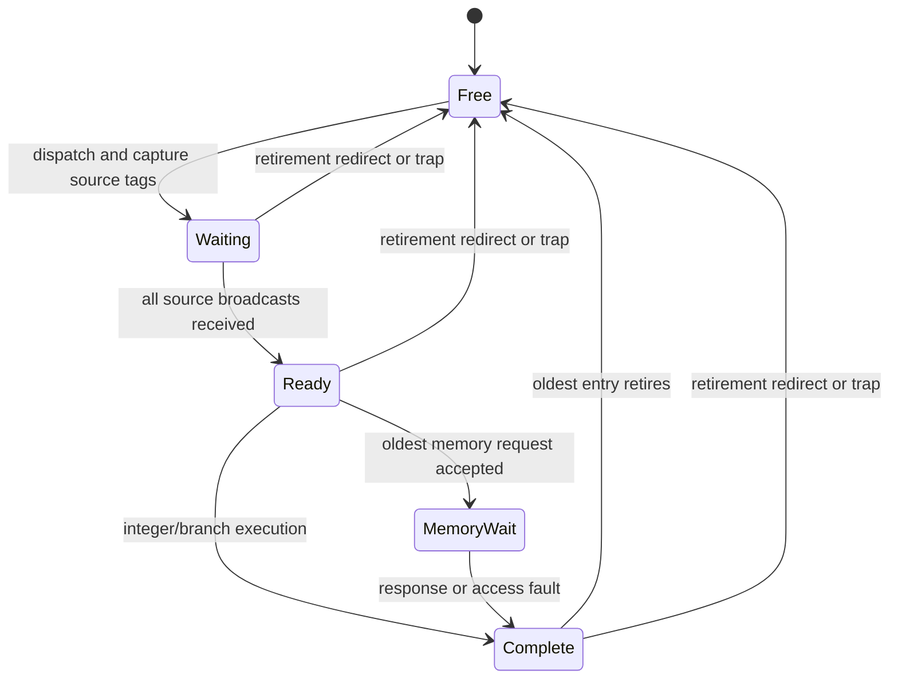

# Single-wide OoO microarchitecture

## State and interfaces

ROB_DEPTH is 16 or 32 (power of two). Dispatch and retirement each accept at most
one instruction per cycle. Each ROB entry doubles as a reservation station:

| Fields | Purpose |
|---|---|
| valid, issued, done | allocation/execution/completion state |
| PC, instruction | precise retirement identity |
| rd, writes_rd | architectural destination |
| source ready/value/tag (two) | dependency tracking |
| result, next_pc, exception/cause | completion and recovery |
| memory address/data/mask | retirement effect record |

An architectural register file holds only retired values. A 32-entry rename
map points at the youngest live producer in the ROB. Sources capture either an
architectural value, a completed producer value, or a tag. Completion broadcasts
wake matching sources. Dispatch also bypasses current completion broadcasts.
Rename x0 is permanently invalid. A retiring destination clears its mapping only
if it is still the youngest producer. This prevents WAW/WAR corruption.

## Scheduler and execution

An oldest-first scan selects one ready, unissued non-memory instruction. The
combinational integer/branch unit completes at the next edge. Independently,
the head memory entry may start a request; its completion uses a second broadcast
port. Thus one ALU result and one memory result can complete together. Loads and
stores calculate addresses only from ready operands. Only the ROB head can issue
externally. Stores become visible at the request handshake, when they are oldest
and cannot be squashed. Memory errors must have no write effect at the responder.
Loads/stores that fault on alignment never send a request.

Branches predict not-taken; JAL/JALR also initially predict PC+4. Resolution can
occur out of order, but recovery waits until the branch retires. All older work
has then committed, so recovery simply clears the ROB and rename map, preserving
the architectural register file. This adds misprediction latency but eliminates
checkpoint and selective rollback complexity. Wrong-path traps cannot halt.

## Backpressure, tags and recovery

ROB full blocks dispatch. A fetch response buffer holds one instruction while
blocked. The circular pointers wrap at ROB_DEPTH; occupancy disambiguates full
and empty. Allocation and retirement can happen at the same edge, except a full
ROB conservatively waits one cycle before reusing a retiring slot. A ROB slot
cannot retire before its completion, and every dependent source has captured
the broadcast before the slot can be reallocated. There is no delayed ALU
completion. The sole memory request belongs to the head and must finish before
retirement; therefore no outstanding memory completion survives a flush.

The fetch frontend never cancels an accepted transaction. On redirect it discards
the buffered response and marks an outstanding response stale. It drains that
response before issuing the redirected PC. A blocked, unaccepted request also
retains its original payload until handshake and is drained as stale. Reset
clears the frontend and requires the memory responder to clear pending work.

## Invariants and limits

* 0 <= occupancy <= depth; live entries form the circular head-to-tail interval.
* Retirement always consumes the valid, completed head, once.
* Every unresolved source tag names a live older writer.
* x0 reads zero; writes have no architectural or rename effect.
* All memory requests belong to the oldest instruction; no wrong-path store
  reaches the interface. Memory is strongly ordered, single-hart, no MMIO
  speculation, no store-to-load forwarding or memory dependence prediction.
* Faults halt precisely. Resuming requires reset; no privileged execution.
* FENCE is an ordering no-op because memory requests already serialize. FENCE.I
  is excluded. Instruction memory must remain immutable during execution.
* No fairness counter is needed: oldest-ready selection plus finite program-order
  retirement prevents starvation provided external memory eventually responds.

Single-wide dispatch does not imply in-order execution. A cache miss can leave a
load and its consumer stalled while younger independent arithmetic completes.
The verification suite must capture execution and retirement order separately.
